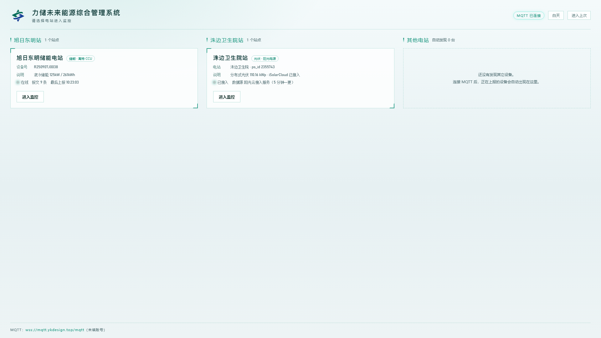
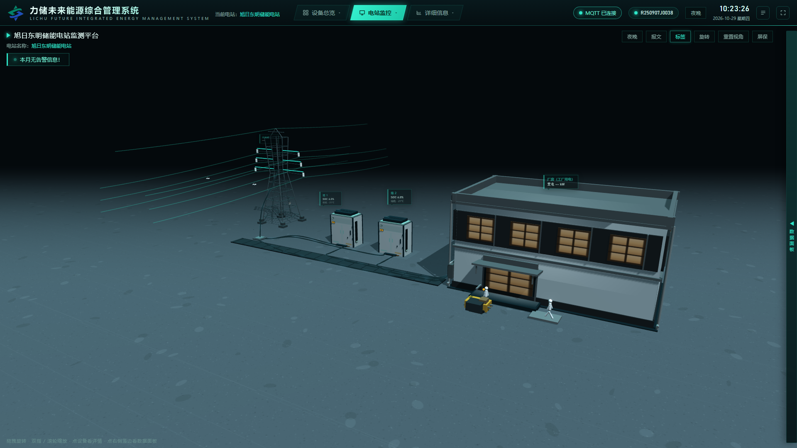
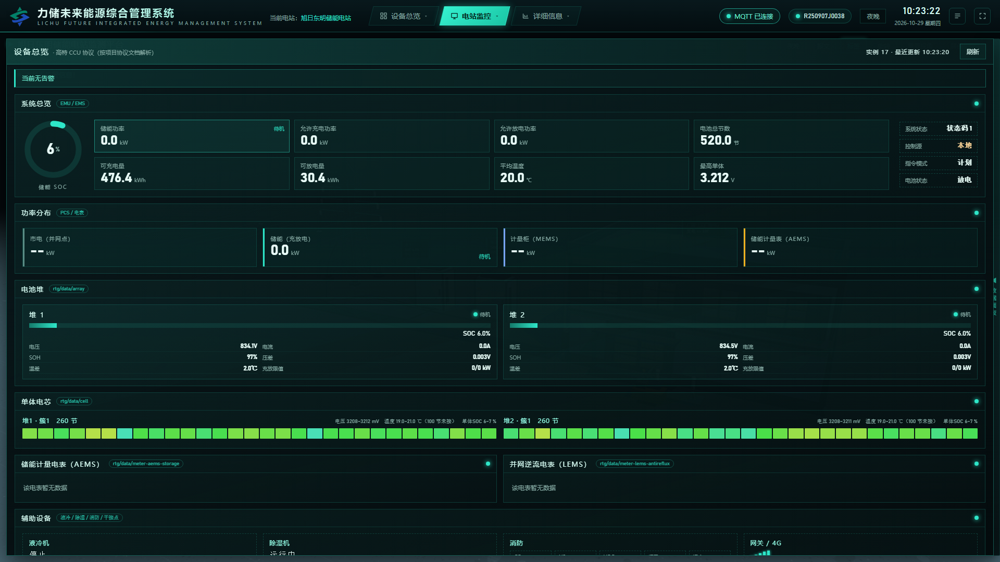
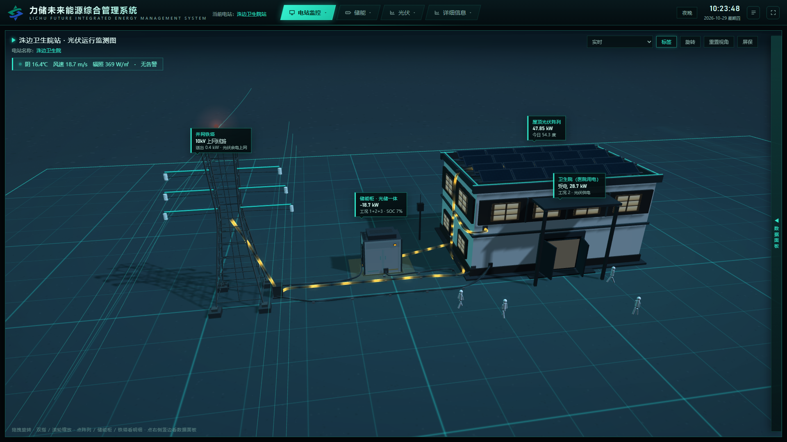

# 力储未来能源综合管理系统

> LICHU FUTURE INTEGRATED ENERGY MANAGEMENT SYSTEM

面向**工商业储能 / 光伏电站**的网页监控平台：一块大屏把三个电站的现场设备（高特 CCU）和两家厂家云的
数据（阳光电源 iSolarCloud、东方日升日升云）汇成统一界面，带三维数字孪生场景和反向下发控制。

**线上入口**：<https://mqtt.ykdesign.top/dianzhan/>（nginx Basic 登录保护）

| | |
|---|---|
| 前端 | 纯静态：`index.html` + 21 个 `js/*.js` + `css/style.css`，**无构建工具**，每个 js 往 `window` 挂一个全局对象 |
| 后端 | `tools/` 下一组常驻 Node 服务（MQTT broker + 网关、两家厂家云的 HTTP 接入、历史采样） |
| 三维 | three.js r128 数字孪生，三个站各一套场景，共用 `js/scene-preset.js` 渲染层 |
| 部署 | 腾讯云 43.129.27.206 · nginx + mosquitto + systemd |

## 给 AI 智能体：最短上手路径

1. **读完这一页**，你就知道这是什么、代码在哪、哪些规则不能破。
2. 要改具体东西 → [`agent-pack/02-代码地图.md`](agent-pack/02-代码地图.md)（每个文件干什么、UI 怎么切、数据怎么流、3D 怎么组织）。
3. 动手前 → 读下面的「红线」，以及 [`agent-pack/05-约定与红线.md`](agent-pack/05-约定与红线.md)。
4. 不能读文件、只能一次投喂 → 用 [`agent-pack/ALL-IN-ONE.md`](agent-pack/ALL-IN-ONE.md) 单文件版。

根目录的 `AGENTS.md` 是精简速查（会自动读项目约定的智能体会先看到它），内容 = 红线 + 文档索引，和这一页不重复。

## 界面

> 截图取自 2026-10-29 的 UI 审计（`ui-audit/`），界面已是当前产品名。

| 站点目录（进门页） | 旭日东明 · 三维电站监控 |
|---|---|
|  |  |

| 设备总览 · 真实报文渲染 | 洙边 · 光伏站三维 |
|---|---|
|  |  |

更多：`ui-audit/gaote-detail-*.png`（详细信息页）、`gaote-health-night-fhd.png`（电芯健康）、
`devices-night-fhd.png`（设备列表）。界面规范在 `ui-audit/ui-spec.html`。

## 三个站、四路数据源

| 站点 | 构成 | 数据从哪来 |
|---|---|---|
| **旭日东明储能电站**（现场口称"莒南站"） | 125 kW/261 kWh 液冷储能柜 ×5 堆；园区厂房为负荷；10 kV 并网铁塔；两台 CCU（`R250907J0038` 在线、`R250907J0037` 离线） | **高特 CCU 设备侧 MQTT**（`/{ProductSN}/{DeviceSN}/rtg\|cmd\|history/...`，30 秒周期） |
| **洙边卫生院光储电站** | 屋顶光伏 110.16 kWp（`ps_id 2355743`）；光储一体柜；卫生院为负荷；墙根三通黑盒是全站并网点 | 光伏走**阳光电源 iSolarCloud**（OAuth2，5 分钟轮询）；储能走**东方日升日升云**（1 分钟轮询）；天气走 Open-Meteo |
| **山东峻涌光储电站**（2026-10-29 上线） | 光伏 972.4 kWp；储能 625 kW/1305 kWh（5 台光储一体柜）；三套机组品字围合共用一座铁塔 | 光伏走**阳光云"第二路"**（另一个账号，`ps_id 2377236` → 8098）；储能走**高特 CCU ×3**（浏览器 MQTT） |
| 其他站点 | 未登记的高特协议设备，自动发现 | 同高特 |

**两家厂商绝不混用**：`solar-*`=阳光电源(光伏)、`risen-*`=东方日升(储能)、`gaote-*`=高特 CCU、`zhhn-*`=晶农 EMS。
账也不能混着算——日升云是结算口径，阳光云只报发电量。

## 数据流

```
现场设备(高特CCU) ──1883/tcp──► mosquitto ◄── mqtt-gateway(8090，鉴权/只读) ◄── nginx /mqtt ◄── 浏览器(wss)
阳光云（洙边）   ──HTTP──► lichu-solar(8096)         ──nginx /solar──►      js/solar.js
阳光云（峻涌）   ──HTTP──► lichu-solar-junyong(8098) ──nginx /junyong/pv──► js/junyong.js
东方日升日升云   ──HTTP──► lichu-risen(8097)         ──nginx /risen──►      js/solar.js
mosquitto ──订阅#──► lichu-history(8095) ──/history,/daily──► js/gaote-detail.js（曲线）
```

前端有两条互不交叉的路径：

- **MQTT 类（旭日东明 / 峻涌储能）**：`GaoteService` 解析 → `DataService.mqttReport()`（`js/data.js`）生成标准快照 → 各视图消费。
  新增 MQTT 数据源走这条路，不用改视图。
- **HTTP 类（洙边 / 峻涌光伏）**：`js/solar.js`、`js/junyong.js` 各自轮询并直接渲染自己的页面，**不经过** `mqttReport`。

## 仓库结构

```
index.html            入口：门户 + 三站监控页（21 个 js 按固定顺序加载，带 ?v= 版本号）
css/style.css         全部样式（日夜双主题，令牌在 :root 与 html[data-theme="day"]）
js/data.js            配置 + MQTT 快照入口 DataService
js/gaote*.js          旭日东明：协议解析 / 总览大屏 / 详细页 / 三维场景 / 策略表单
js/solar*.js          洙边站：HTTP 轮询 / 页面渲染 / 三维场景
js/junyong*.js        峻涌站：阳光云第二路 + 三台 CCU / 三维场景
js/scene-preset.js    三站共用渲染层（环境贴图/曝光/泛光/阴影等观感参数的唯一真源）
js/mqtt*.js           晶农 EMS 协议 + 接线中枢（连接面板、报文日志、页签分发）
js/portal.js          站点目录（进门页）
js/main.js            启动引导：异步注入 libs → 主题 → 选三维模块 → 绑定 UI
libs/                 第三方库（three r128 / echarts 5.4.3 / mqtt），原样使用，别改
tools/                Node 服务、模拟器、点表生成、部署与诊断脚本
agent-pack/           交接文档（给 AI / 新人的，先读这个）
ui-audit/             2026-10-29 UI 审计截图、度量数据与界面规范
views/                工程视图 PNG，建模时对齐用
*-demo.html           本地调试页（未部署，不接真实链路）；solar-preview.html 是洙边旧预览页
```

## 本地跑起来

需要 Node 18+ 和 Python（只用来起静态服务器）。**aedes 必须锁 `0.51.3`**，装成 1.x 在 Node 24 上会"连得上但收不到 CONNACK"。

```bash
cd tools && npm i

node tools/local-broker.js      # 本地 broker：TCP 1884 + WS 9001
node tools/gateway.js --upstream mqtt://127.0.0.1:1884 --listen 9002
node tools/ccu-simulator.js --url mqtt://127.0.0.1:1884 --dsn SN2025B3781TEST --interval 5
python -m http.server 8080 --bind 127.0.0.1    # 在仓库根目录执行
```

浏览器打开 `http://127.0.0.1:8080/index.html`，右上角数据源面板填：

| 项 | 值 |
|---|---|
| 协议 | 高特 CCU（本项目） |
| 地址 | `ws://127.0.0.1:9002/mqtt` |
| ProductSN | `kp23bhcpmt91n2v8` |
| 设备 SN | `SN2025B3781TEST`（要与模拟器 `--dsn` 一致） |

端口：1884 broker(TCP) · 9001 broker(WS) · 9002 本地网关 · 8080 站点 · 8095 历史 · 8096 阳光云(洙边) · 8097 日升云 · 8098 阳光云(峻涌) · 8099 阳光云本地转发。
**别用 1883**——本机常有 Cooler Master 的 `CMAgent.exe` 占着，它自带一个能用的 broker，会把数据吞掉。

## 红线（改动前必读）

1. **改了 js/css，必须提 `index.html` 里对应文件的 `?v=YYYYMMDD字母` 版本号**。每个文件各管各的，跨天回到 `a`；忘了提 = 线上"看着没变"。
2. **页面不许有任何模拟/演示数据**，没数据就显示 `--` / 0。模拟只允许出现在本地的 `*-demo.html`（未部署、不接真实链路）。
3. **公开仓库，任何口令 / token / 账号 / 服务器密码都不许进代码**。凭据类文件已在 `.gitignore`；新脚本从 `SRV_PASS` 等环境变量取口令。
4. **别动 `libs/`**；别在脚本顶层引用 `THREE` / `echarts` / `mqtt`（由 `main.js` 异步注入，要用时在函数内惰性取）。
5. **颜色和观感参数只进主题表**（`THEMES` / `FLOWC` / `TEXPAL` / `scene-preset.js` 的 `ENV` / `:root`），不要内联写死；
   材质要经 `regThemeMat()` / `regMat()` 注册才会随主题切换。语义配色：光伏=黄、电网=蓝、储能放电=青绿、馈电=橙。
6. **功率符号**：正=放电、负=充电；关口表正=取电、负=馈电；光伏 `null ≠ 0`（没数据不等于零发电）。
7. **点表是生成物**：`js/gaote-points.js` 由 `python tools/gen-gaote-points.py` 从 `refs/*.xlsx` 生成，别手改。
   （`refs/` 是厂家协议原件、不入库；拿不到源文件时只能直接改生成物，请在提交信息里写明原因。）
8. **3D 场景**：不许穿模、不许共面闪烁（z-fighting）、别加看不懂的装饰；标签随距离缩放并被模型遮挡时隐藏。
   改设备位置要连带重核电缆路径与默认机位（详见 `agent-pack/02` 第二节）。

## 改完怎么算完成

1. `node --check` 过一遍改动的 js；
2. 浏览器里真跑一遍（连真实数据源或现场报文重放），走完相关页签，看控制台报错；
3. 看渲染结果（截图），不要只靠读代码或算几何下结论；
4. 涉及业务数值 → 与厂家后台 / 设备原始报文逐字段对照；
5. **部署到服务器才算交付**：前端把 `index.html/css/js/libs` 传到 `/var/www/lichu`，服务用 `tools/deploy-<svc>.js`。
   注意 `tools/deploy-site.js` **不在仓库里**（内嵌服务器口令，被 `.gitignore` 排除），详见 `agent-pack/03` 的「前端怎么传」。

## 继续读

| 文件 | 内容 |
|---|---|
| `AGENTS.md` | 给 AI 的精简速查（红线 + 文档索引） |
| `agent-pack/README.md` | 交接包入口：按顺序读哪几份、三条最易踩的坑 |
| [`agent-pack/01-项目总览.md`](agent-pack/01-项目总览.md) | 站点、数据源、线上拓扑、协议现状 |
| [`agent-pack/02-代码地图.md`](agent-pack/02-代码地图.md) | 每个 js 干什么、UI 怎么切、数据怎么流、3D 场景怎么组织 |
| `agent-pack/03-本地开发与部署.md` | 命令、端口、常见坑、部署、GitHub 推送通路 |
| `agent-pack/04-领域与业务规则.md` | 工况判定、配色口径、电价与收益口径 |
| `agent-pack/05-约定与红线.md` | 编辑约定、数据纯度、凭据纪律、3D 规则、验收标准 |
| `agent-pack/06-未闭环与坑.md` | 待厂家确认、已知遗留缺陷、本机环境坑 |
| `agent-pack/07-洙边-当前状态与交接.md` | 洙边 3D 定稿：九条线亮灯条件、六工况、接线盒、演示页 |
| `更新记录.md` | 按版本倒序的变更日志（部署时同步维护） |

## 术语

- **产品名**「力储未来能源综合管理系统」；旧名「力储未来远程监控平台」已废弃，不该再出现。
- **站名 ≠ 产品名**：「旭日东明储能电站」这类是现场实体名，不随产品改名而改。
- **堆** = 一个储能柜（高特协议 `array`/`cluster` 维度）；**簇** = 柜内电池簇；**关口表** = 并网点计量。
- **六工况**：每个站的 3D 场景按"电从哪来、到哪去"判定工况，决定哪几条线的亮/灭与流向。口径见 `agent-pack/04`。
